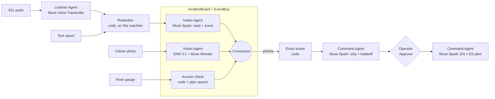

# Crisis Command Swarm

**A human-led agent swarm for Richmond flood operations. The swarm triages, humans decide.**

> **Simulation only.** All incidents, units, gauge readings, imagery and outcomes are
> synthetic. Street geometry is real (OpenStreetMap), but the response network, fleet and
> scenario are invented for this exercise. Nothing is dispatched. This is not a certified
> emergency system.

## Who it is for

An Emergency Operations Manager in Richmond, VA during a James River / Shockoe Bottom flash
flood. Reports arrive as messy 911 calls, photos and radio traffic; several incidents compete
for a few boat teams; roads close while units are moving. The manager has to make the first
critical decision fast, and be able to defend it.

**One workflow:** Detect → Prioritize → Decide → Dispatch → Communicate.

## Impact

- **Goal:** the first critical decision in about 90 seconds. Our brief compares this with
  47 minutes today; we have no source or measurement for that 47-minute baseline, so we do
  not claim it.
- **Measured (live, Muse Spark 1.3, 3 trials):** a raw 911 transcript became the top-ranked,
  explained recommendation, ready for the operator's Approve click, in **18–22 seconds**
  (7.6–10.8 s to read the report, about 11 s for the swarm vote, exact plan and
  explanation).
- **Measured (demo replay):** the whole seeded timeline, from five open incidents to a
  re-ranked plan after a new rescue and a road closure, runs in about 50 seconds with no
  typing and no network.

The operator still decides: nothing is dispatched without **Approve & Dispatch**.

## What you see

One screen, three panels:

| Left: Swarm Incident Queue | Center: Live map of Richmond | Right: Recommendation + Activity |
|---|---|---|
| Ranked by consensus; each card shows `Intake 95 · Vision 90 · Access 100 = Final 98` with each vote's source | Satellite basemap, incident rings, unit dots, recommended routes, closed roads in black, blue flood-water mask | RECOMMEND / WHY / CONFIDENCE (vote agreement) / TRADEOFF, Approve & Dispatch, then the English and Spanish public alert; below, a live log of every agent action |

Above the panels, four agents (Listener, Intake, Vision, Command) can be clicked to see
their role, models, current votes and activity. Every AI output carries a pill showing where
it really came from: `live`, `cache` (a recorded real response), `local` (code on this
machine) or `sample` (hand-made data for a model this account cannot reach).

## How it works: a swarm on a shared board



- **IncidentBoard** (`crisis_command/swarm/board.py`) is one shared store; agents write votes
  and observations to it, and the **EventBus** tells the others. There is no fixed pipeline:
  a flood-cover change makes Vision and the access check re-vote; a road closure, gauge change,
  dispatch or resolution makes the access check re-run; any consensus change re-plans.
- **`spawn_incident_swarm(incident_id)`** runs the Intake vote, the Vision vote and the
  access check in parallel for one incident.
- **Consensus, not one model:** final severity is the median of three votes (Intake: Muse
  Spark; Vision; the access check: code) pulled halfway toward the highest (82, 96, 91 → 94),
  so no single voter, and no single model, sets the priority alone.
  CONFIDENCE is how closely the three votes agree, labelled as agreement, not a probability.
- **Deterministic where it matters:** routes, unit assignment (an exact integer program),
  capacity, availability and feasibility checks are code, not model output. The AI reads,
  scores and explains; the solver decides who goes where; the human approves.
- **Agents never write world state.** Only the command service commits changes, and approval
  is bound to the exact plan and world version.

## Models

All model calls live in one file, [`crisis_command/meta_api.py`](crisis_command/meta_api.py),
with a cached fallback for each.

Four agents; everything else is deliberately plain code.

| Agent | Job | Meta model | Status |
|---|---|---|---|
| Listener | 911/radio audio → text | Muse Voice Transcribe | **sample**: transcripts written for the demo |
| Intake | Reads every report into strict JSON (type, location, people, needs) and votes urgency 0–100 | Muse Spark | **live** (recorded for demo replay) |
| Vision | Flood mask and depth/passability from a photo | SAM 3.1 + Muse Wonder | **sample**: hand-made mask and estimate, each labelled "not model output" |
| Command | Explains the solver's recommendation (why, tradeoff); writes the EN/ES alert after approval | Muse Spark (+ Muse Image for a graphic) | Spark **live**; Muse Image **not connected**, no graphic is faked |

| Code (not agents) | What it does |
|---|---|
| Redaction | Strips names, phones and emails on this machine before any cloud call |
| Access check | Scores how fast units can reach each incident over open roads (third vote); cites the sample flood plan via local keyword search |
| Exact solver | Routes and unit assignment (integer program), capacity and availability checks |
| Coordinator | Spawns the swarm, applies only confirmed changes, never dispatches without approval |

**Record and replay.** In live mode every Muse Spark response is saved under
`demo_cache/responses/`. START DEMO SCENARIO replays only those recordings, so the demo is
reliable offline and every answer in it is a real model answer. If a live call fails, the
hub uses the recording, then rules, and logs the fallback to the activity feed. If nothing
is recorded, the report is shown as unread rather than invented.

**Sample knowledge base.** `demo_cache/knowledge/` holds a flood response plan, shelter list
and gauge triggers written for this exercise. They are marked as exercise documents, not
City of Richmond material; citations say "Sample Richmond Flood Response Plan".

## Send a report from another device

The top-right corner of the dashboard shows the report address: `http://localhost:3000/report`,
plus this computer's network address for a phone on the same Wi-Fi. Reports can be typed, or
spoken (Muse Voice Transcribe). They go through normal intake: the Intake Agent reads them, the
agents score them and the planner re-plans. Dispatch still needs approval. Browsers only
allow the microphone on `localhost` or https, so on a phone over plain http use the typed form.

## Trust: no invented facts

- **Grounding rule** in every Muse Spark prompt: never invent a shelter, capacity, road status,
  evacuation zone, unit, place, time or number; cite the given facts or say unknown.
- **Unsupported-number check:** any number in the model's explanation or alert that is not in
  the facts it was given is shown to the operator as "Unverified".
- **Plan search answers only from the documents:** with no matching passage it says "Not in
  Richmond plan - requires human verification".
- **Source and time on facts:** each incident shows the report it came from (or "scenario
  seed"), and each closed road shows what closed it and when.
- **Estimates are labelled as estimates:** Wonder's depth is an ESTIMATE with model-stated (not
  calibrated) confidence; severity is a consensus of estimates; confidence is vote agreement.
- **No shelter capacities are shown,** because there is no source for them. The sample
  knowledge base says capacity is not modelled.

## Evaluation

**Intake Agent triage on 20 sample incidents** (`python -m evaluation.triage_eval`; recordings in
`evaluation/triage_cache/`, results in `evaluation/triage_results.json`). Raw report text
only; the 0–100 score is mapped to the rubric class with bands fixed before running
(critical ≥ 80, high 60–79, medium 40–59, low < 40).

| Metric | Muse Spark 1.3 |
|---|---|
| Exact severity class | **15 / 20** (75%) |
| Within one class | **20 / 20** |
| Critical reports scored critical | **6 / 6** |
| Misses | 5, all one class too high: 3 high → critical, 1 low → medium, 1 medium → high |

The Triage score errs toward over-triage on this set. A separate test with the same 20
reports (`findings/`), where Muse Spark filled in the rubric's fields directly, matched the
answer key on 20/20 severities in 3 of 3 runs. Caveats: the reports and keys were written by
the project author, and 20 is a small set; a held-out set written by someone else is still
needed.

**Other checks**

| Check | Result |
|---|---|
| Exact solver vs brute force (60 random instances) | Optimal on all 60 (`tests/test_planner_optimal.py`) |
| Demo replay, offline | Same queue, routes and recommendation as the live recording; 0 fallbacks (`tests/test_demo.py`) |
| Planner scenario variants (`python -m evaluation.run_eval`) | Expected outcome in every variant, 3 runs each |
| Automated tests (`python -m unittest discover -s tests`) | 86 passing |

## Pilot story: City of Richmond (proposal)

This is a proposal; we have not contacted or worked with the City.

1. **Tabletop first.** Run the demo scenario and two historical James River flood timelines
   with Richmond emergency management staff in a training room, with no live data.
2. **Measure what matters.** Time to first critical decision with and without the swarm,
   how often operators override the recommendation and why, and triage accuracy on
   reports written by Richmond dispatchers rather than by us.
3. **Swap samples for real feeds.** The USGS Westham gauge (02037500) has a public feed; the
   City's actual flood plan and shelter list would replace the sample knowledge base, and
   connecting SAM 3.1 and Muse Voice Transcribe would replace the sample imagery and
   transcripts.
4. **Keep the human in charge.** The swarm only ranks, explains and drafts; dispatch stays
   with the operator.

## Meta tooling, used honestly

- **Muse Spark** does the reading, triage scoring, explanation and bilingual alerts, with
  strict JSON schemas and `store: false`.
- **Record/replay hub:** one file owns every model call; live answers become the offline
  demo, so judges see real model output without needing network access.
- **Offline by design:** redaction and plan search are code on this machine, so they work
  without internet and send nothing anywhere.
- **Clear labels:** models this account cannot reach are shown as such instead of being
  simulated as if they ran.

## Run it

```powershell
pip install -r requirements.txt
cd app; npm install; cd ..

# API (put META_API_KEY / META_MODEL / META_BASE_URL in crisis_command/agents/.env; see .env.example)
python -m uvicorn crisis_command.api.server:app --port 8000

# Dashboard
cd app; npm run dev        # http://localhost:3000, press START DEMO SCENARIO
```

- `POST /api/demo/start` replays the recorded run; `POST /api/demo/start?record=true` calls
  the live model and re-records.
- Without a key, the app still runs: votes fall back to rules and say so.
- Tests: `python -m unittest discover -s tests`.

## Limits

- One scenario type (Richmond flood) and one simulated fleet; no real dispatch.
- Unit movement on the map is animated in the browser, not simulated in the backend.
- Shelter capacity, crew fatigue and multi-trip rescues are not modelled.
- Vision, transcription and alert graphics use sample data until those models are connected.
