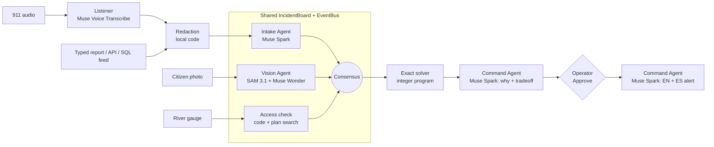

# Crisis Command

**A human-led agent swarm for flood response in Richmond, VA. The agents triage, the solver plans, a person decides.**

Built for the Meta AI Developer Hackathon on Meta's Muse Spark, Muse Voice Transcribe, SAM 3.1
and Muse Wonder.

> **Simulation only.** Incidents, units, unit positions, gauge readings and outcomes are
> synthetic. Street geometry is real (OpenStreetMap); the fleet and the scenario are invented.
> Nothing is dispatched. This is not a certified emergency system.

---

## The problem

During a James River / Shockoe Bottom flash flood, an Emergency Operations Manager gets messy
911 calls, citizen photos and radio traffic all at once. Several incidents compete for a few
boat teams, and roads close while units are moving. The manager has to make the first critical
decision fast, and be able to defend it afterwards.

Crisis Command runs one workflow: **Detect → Prioritize → Decide → Dispatch → Communicate.**

## What it does

1. **Listens.** A 911 call is transcribed live by **Muse Voice Transcribe**. Names, phone
   numbers and emails are redacted on this machine before any other cloud call.
2. **Reads.** **Muse Spark** turns the report into structured fields (type, place, people,
   needs) and votes on severity.
3. **Looks.** A citizen photo goes to **SAM 3.1** (boxes for flooded street, vehicles, smoke)
   and **Muse Wonder** (estimated water depth, whether the road can be driven, fire). A road it
   judges impassable is closed on the map.
4. **Agrees.** Three independent votes (Intake, Vision, and a computed access check) are combined
   into one severity. No single model sets the priority.
5. **Plans.** An exact solver (an integer program, SciPy `milp`, with networkx road routing)
   assigns units to incidents. The plan comes from the solver, not from the LLM.
6. **Explains.** Muse Spark explains the plan (what, why, confidence, tradeoff), and every number
   it uses is checked against the facts it was given.
7. **Waits for a person.** Nothing moves until the operator presses **Approve & Dispatch**. Then
   Muse Spark writes the English and Spanish public alert.

When new information arrives (a road closes, the gauge rises, a rescue finishes and frees a
team), the agents re-vote and the solver re-plans.

## The screen

| Tab | What's on it |
|---|---|
| **Operations map** | Left: people affected, live transcript, the photo with SAM boxes, and the ranked incident queue (each card shows its three votes and their sources). Center: MapLibre on satellite imagery with toggles for flood zones, fire, units, closed roads, power outages, hospitals and shelters. Below the map is a time scrubber: up to 2 h of recorded history, then a +1 to +4 h trend projection labelled "not a hydrologic forecast". Right: the recommendation, Approve & Dispatch, the public alert and the activity feed. |
| **Personnel** | All 8 units: status, capabilities, simulated position, the orders from approved plans, and the public broadcasts. |
| **Agents & decisions** | For each incident, every agent's score and reasons and the consensus, plus each agent's own panel. |
| **`/report`** | Anyone, from a phone on the same Wi-Fi too, can type or speak a report. It goes through normal intake. |

## Demo walkthrough (about 3 minutes)

Set `DEMO_ENABLED=true` in `.env`. The demo replays recorded real model answers, so it works
offline and gives the same result every time.

1. Press **Demo**. Five incidents are open on a seeded Richmond flood.
2. Press **▶** (or the **→** key) once per event:
   1. a 911 call about a bus stuck in floodwater (live transcript, scored by the swarm)
   2. a citizen photo: SAM boxes the water, Wonder judges Dock St impassable, and Dock St closes
   3. the James River gauge rises from 11.2 to 11.8 ft, and the plan changes
3. Read the recommendation and press **Approve & Dispatch**. Units move and the bilingual alert
   goes out.
4. Press ▶ twice more: a Hull St 911 call, then a finished Riverside rescue that frees a team.
5. Approve the new plan. That's the full loop.

## Architecture



- **A shared board instead of a fixed pipeline.** Agents write votes to one `IncidentBoard`, and
  an `EventBus` notifies the others. New flood cover makes Vision and the access check re-vote; a
  road closure, gauge change or dispatch re-runs the access check; any change in consensus
  triggers a new plan.
- **Consensus:** the median of the three votes, pulled halfway toward the highest (82, 96, 91 →
  94). Confidence is how closely the votes agree, labelled as agreement, not a probability.
- **Code where it has to be exact:** routing, unit assignment, capacity, availability and
  feasibility checks. The solver matches brute force on 60 of 60 random instances.
- **Agents never write world state.** Only the command service commits changes, and each
  approval is tied to the exact plan and world version it was shown. A stale plan can't be
  approved.

## Meta models

| Agent | Model | Job |
|---|---|---|
| Listener | Muse Voice Transcribe (`muse-voice-transcribe-1.0`, realtime WebSocket) | 911 audio to text |
| Intake | Muse Spark (`muse-spark-1.3`) | Report to strict JSON; severity vote |
| Vision | SAM 3.1 + Muse Wonder (`muse-wonder-1.0`) | Flood, vehicle and smoke boxes; depth, passability, fire |
| Command | Muse Spark | Explains the plan; writes the EN/ES alert |

One API key covers all of them, and every call goes through one file:
[`crisis_command/meta_api.py`](crisis_command/meta_api.py). **Muse Image** was used only to make
the test photos, and they're labelled as AI-generated.

**Record and replay.** In live mode every model answer is saved to `demo_cache/responses/`, and
the demo replays only those recordings, so everything in it is a real model answer. If a live
call fails, the app uses the recording, then rules, and says so in the activity feed.

## Trust: no invented facts

- Every Muse Spark prompt carries a **grounding rule**: never invent a shelter, capacity, road
  status, evacuation zone, unit, place, time or number.
- **Unsupported-number check:** any number in an explanation or alert that isn't in the model's
  input is flagged **⚠ Unverified** to the operator.
- **Plan search answers only from the documents.** With no match it says *"Not in Richmond plan
  – requires human verification."*
- **Every fact shows its source and time** (a report ID or "scenario seed"), and every closed
  road shows what closed it.
- **Estimates are labelled as estimates.** Wonder's depth carries model-stated, uncalibrated
  confidence, and severity is marked "est.".
- **No made-up capacities.** Shelters and hospitals say "beds/capacity: no feed connected".
- **Contradictions are caught.** When Wonder once said the road was dry but impassable, the app
  logged it and used the safer reading.

## Results

All numbers below were measured in this repo. The test sets are small and synthetic; the
reports and answer keys were written by the project author.

| What | Result | How to reproduce |
|---|---|---|
| Intake triage, 20 labelled reports | **15/20** exact class, **20/20** within one class, **6/6** critical caught; all 5 misses were one class too high | `python -m evaluation.triage_eval` |
| Voice, 6 synthesized 911 calls | Word error rate **9.1%** (3.9% with numbers normalized); known miss: "Shockoe" heard as "Chaco" | `python -m evaluation.voice_eval` |
| Vision (Wonder), 6 AI-generated photos | Water 6/6, fire 6/6, passable 5/6, depth band 4/6 | `python -m evaluation.vision_eval` |
| SAM 3.1 | 3 flooded-street regions (about 54% of the photo) and 28 cars found; the dry photo correctly returns 0 | `evaluation/sam_results.json` |
| Live end-to-end latency | **18–22 s** from a raw 911 transcript to an explained recommendation ready to approve | live runs, Muse Spark 1.3 |
| Exact solver vs. brute force | Optimal on **60/60** random instances | `tests/test_planner_optimal.py` |
| Planner scenario variants | Expected outcome in 12/12 variants × 3 runs; 0 invalid plans committed | `python -m evaluation.run_eval`, [docs/evaluation.md](docs/evaluation.md) |
| Automated tests | **105 passing** | `python -m unittest discover -s tests` |

There's also a separate study in [`findings/`](findings/README.md) comparing a person, classic
algorithms and Muse Spark on the same six tasks, which informed what the AI does and what code does.

## Run it

Requires Python 3.12+ and Node 20+.

```powershell
pip install -r requirements.txt
cd app; npm install; cd ..

copy .env.example .env        # add META_API_KEY; set DEMO_ENABLED=true for the demo

python -m uvicorn crisis_command.api.server:app --host 0.0.0.0 --port 8000
cd app; npm run dev           # http://localhost:3000   (report page: /report)
```

- **Without a key** the app still runs: the demo replays recordings, and live votes fall back
  to rules and say so.
- **Restart the API** after editing `.env`.
- **The microphone** works only on `localhost` or https. On a phone over plain http, use the
  typed form.
- `python tools/record_demo.py` re-records the demo against the live models.

### Modes

- `DEMO_ENABLED=false` (default): **live intake.** Real Richmond roads and the simulated fleet,
  with no incidents. Reports come from:
  1. the `/report` page
  2. `POST /api/intake`, e.g. `{"text": "...", "source": "CAD", "external_id": "C-123"}`
     (send `Authorization: Bearer <INTAKE_TOKEN>` if one is set)
  3. a SQL connector that polls a table with columns `id`, `text` and `source`
     (`CONNECTOR_SQL_URL`, sqlite or postgresql)
- `DEMO_ENABLED=true`: the seeded flood, stepped by the presenter.

## Project layout

```
crisis_command/
  meta_api.py        every Meta model call: record/replay, grounding rule, number check
  swarm/             the shared board, the agents and the votes
  operations/        intake, planning, approval (service.py); the stepped demo (demo.py)
  planner.py         exact integer-program solver and routing
  api/               FastAPI server, map layers, history and projection
  connectors.py      SQL report connector
app/                 Next.js dashboard (MapLibre map, tabs, /report page)
demo_cache/          the scenario, recorded model answers, sample flood plan
evaluation/          triage, voice, vision and planner evals with saved results
findings/            human vs. algorithm vs. AI study
test_media/          AI-generated test photos and synthesized 911 calls
tests/               unit and end-to-end tests
```

## Limits

- One scenario type (a Richmond flood) and one simulated fleet of 8 units. No real dispatch,
  GPS, power grid, hospital bed or CAD feeds; the connectors are in place for them.
- SAM 3.1 returns boxes; its masks aren't decoded yet. The photo's map position is an assumed
  footprint around Dock St, not georeferenced.
- On the seeded incidents, the Vision scores come from labelled sample flood cover.
- The +4 h view is a straight-line trend from the gauge, not a flood forecast.
- The sample flood plan and shelter list in `demo_cache/knowledge/` were written for this
  exercise. They aren't City of Richmond documents.
- No practitioner has reviewed this yet.

## Next step: a City of Richmond pilot (proposal)

We haven't contacted the City; this is a proposal.

1. **Tabletop exercise** with Richmond emergency management staff, using this scenario and two
   historical James River flood timelines, with no live data.
2. **Measure** time to the first critical decision with and without the swarm, how often
   operators override the plan and why, and triage accuracy on reports written by real dispatchers.
3. **Connect real feeds:** the USGS Westham gauge (02037500), the City's flood plan and shelter
   list, and CAD.
4. **Keep a person in charge.** The swarm ranks, explains and drafts. Dispatch stays with the
   operator.

## How it was built

Built by Julian Chaoul, with Claude Code as a coding assistant.
