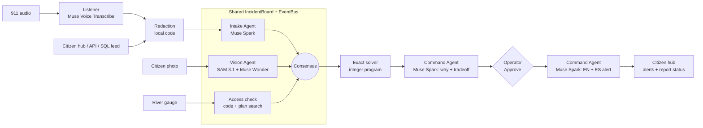
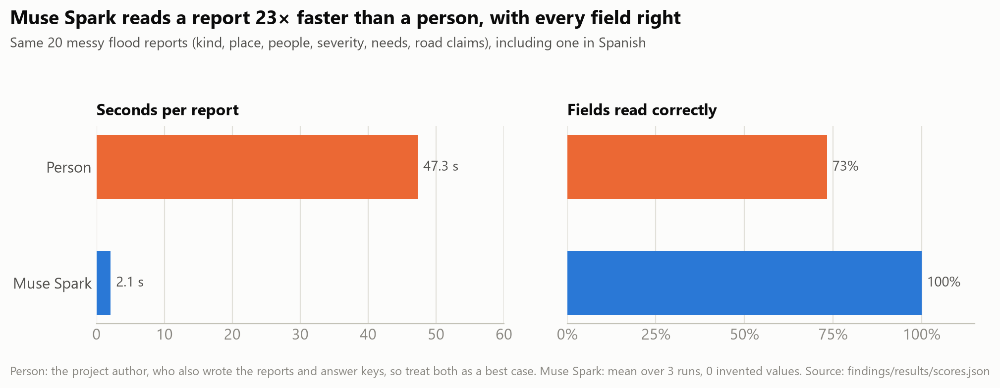
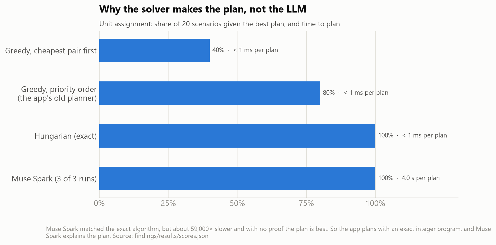
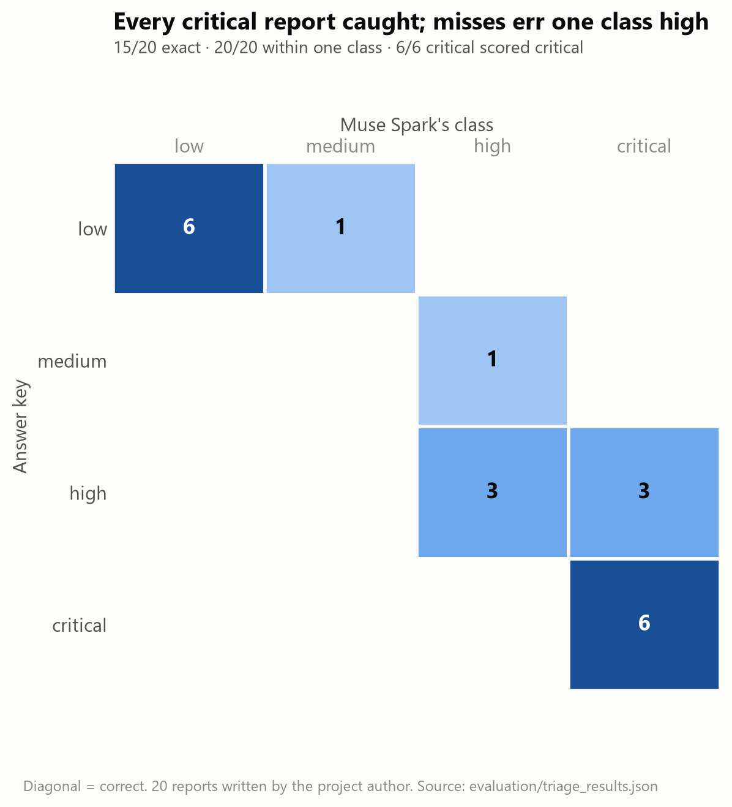
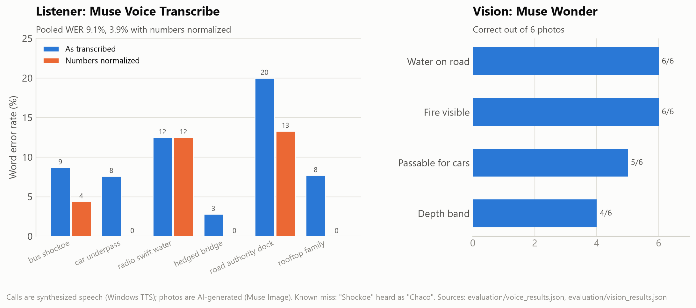

# Crisis Command

**A human-led agent swarm for city emergency operations. The agents triage, the solver plans, a
person decides.**

Built for the Meta AI Developer Hackathon on Meta's Muse Spark, Muse Voice Transcribe, SAM 3.1
and Muse Wonder. The engine has no city or hazard built into it: a city is a scenario (places,
roads, crews, local plans). The bundled demo is a flash flood in **Richmond, VA**.

> **Simulation only.** Incidents, units, unit positions, gauge readings and outcomes are
> synthetic. The demo's street geometry is real (OpenStreetMap); the fleet and the scenario are
> invented. Nothing is dispatched. This is not a certified emergency system.

---

## The problem

When a disaster hits a city, the emergency operations center gets messy 911 calls, citizen
photos and radio traffic all at once. Several incidents compete for a few crews, roads close
while units are moving, and residents don't know what happened to the call they made. The
operations manager has to make the first critical decision fast, and be able to defend it
afterwards.

Crisis Command runs one workflow: **Detect → Prioritize → Decide → Dispatch → Communicate**, and
keeps residents in the loop through a citizen hub.

## What it does

1. **Listens.** A 911 call is transcribed live by **Muse Voice Transcribe**. Names, phone
   numbers and emails are redacted on this machine before any other cloud call.
2. **Reads.** **Muse Spark** turns the report into structured fields (type, place, people,
   needs) and votes on severity.
3. **Looks.** A citizen photo goes to **SAM 3.1** (boxes for flooded street, vehicles, smoke)
   and **Muse Wonder** (estimated water depth, whether the road can be driven, fire). A road it
   judges impassable is closed on the map.
4. **Agrees.** Three independent votes (Intake, Vision, and a computed access check) are combined
   into one severity. No single model sets the priority.
5. **Plans.** An exact solver (an integer program, SciPy `milp`, with networkx road routing)
   assigns crews to incidents. The plan comes from the solver, not from the LLM.
6. **Explains.** Muse Spark explains the plan (what, why, confidence, tradeoff), and every number
   it uses is checked against the facts it was given.
7. **Waits for a person.** Nothing moves until the operator presses **Approve & Dispatch**. Then
   Muse Spark writes the English and Spanish public alert.
8. **Keeps residents informed.** Anyone can report from the citizen hub and follow their own
   report through to "resolved", and see the approved public alerts and closed roads.

The plan updates whenever something changes: a road closes, the river rises, a more urgent call
comes in, or the agents re-vote. It can reroute a crew already on a lower-priority call, the
panel lists exactly what would change, and each change is approved again. **✓ Resolved** on an
incident takes it out of the queue, tells every agent to drop it, stands its crews down and
re-plans with them.

## The screen

| Tab | What's on it |
|---|---|
| **Operations map** | Left: people affected, live transcript, the photo with SAM boxes, and the ranked incident queue (each card shows its three votes and their sources, and a Resolved button). Center: MapLibre on satellite imagery with toggles for flood zones, the projected flood, fire, units, closed roads, power outages, hospitals and shelters. Below it, a time scrubber (up to 2 h of recorded history) and an always-on trend projection for +1 to +4 h, labelled "not a forecast". Right: the recommendation, what it changes, Approve & Dispatch, the public alert and the activity feed. |
| **Personnel** | Every crew: status, capabilities, simulated position, every order it received (dispatch, reroute, stand down), and the public broadcasts. |
| **Agents & decisions** | For each incident, every agent's score and reasons and the consensus, plus each agent's own panel. |
| **`/report`: citizen hub** | For residents, on their phones. **Alerts**: approved English/Spanish public alerts, closed roads and the river gauge. **Report**: type or speak a report; it goes through normal intake. **My reports**: each report this phone sent, tracked by a private receipt, with live status (received → on the command screen → help dispatched, naming the crews → resolved), and the real reason when no crew can be sent yet. Nobody sees anyone else's reports. |

## Demo walkthrough: Richmond flash flood (about 3 minutes)

Set `DEMO_ENABLED=true` in `.env`. The demo replays recorded real model answers, so it works
offline and gives the same result every time.

1. Press **Demo**. Five incidents are open on a seeded James River / Shockoe Bottom flood, with
   12 crews.
2. Press **▶** (or the **→** key) once per event:
   1. a 911 call about a bus stuck in floodwater (live transcript, scored by the swarm)
   2. a citizen photo: SAM boxes the water, Wonder judges Dock St impassable, and Dock St closes
   3. the James River gauge rises from 11.2 to 11.8 ft, and the plan and projection change
3. Read the recommendation and press **Approve & Dispatch**. Crews move and the bilingual alert
   goes out.
4. Press ▶: a critical 911 call from the Hull St underpass. Every crew is out, so the solver
   reroutes two of them to it and the Manchester dialysis transfer waits. Approve.
5. Press ▶: the Riverside rescue reports everyone safe. The incident closes, its crews stand down,
   and the plan covers the waiting call again. Approve. That's the full loop.

Open `/report` on a phone at any point to send a report and watch it appear on the command
screen.

## Any city, any incident

Nothing in the agents, intake, solver, approval flow or citizen hub knows about Richmond.
A city comes in through a **scenario** (`crisis_command/operations/scenario.py`):

- its **places and roads** (the routing graph) and the readable street names people use
- its **crews**: each unit's capabilities (fire, medical, rescue, police, utility), speed and
  capacity
- its **name, hazard and operations label**, which the model prompts, public alerts and screen
  labels read, so they name the right city and hazard
- its **local plans**: the documents the plan search cites (`demo_cache/knowledge/`)

Incident types are free text and crews are matched by capability, so fires, collisions, outages
and medical calls already flow through the same pipeline. The flood-specific pieces (river gauge,
flood cover, the projection) are layers on top.

**What adapting a new city takes today:** a new `Scenario`, a street-geometry file for the map
(`tools/build_richmond_geo.py` builds Richmond's from OpenStreetMap), and its plan documents. The
map module (`crisis_command/api/geo.py`) is currently wired to the Richmond places, so reading
geometry per scenario is the first change to make. Richmond is the only scenario bundled.

## Architecture



- **A shared board instead of a fixed pipeline.** Agents write votes to one `IncidentBoard`, and
  an `EventBus` notifies the others. New flood cover makes Vision and the access check re-vote; a
  road closure, gauge change or dispatch re-runs the access check; any change in consensus
  triggers a new plan.
- **Consensus:** the median of the three votes, pulled halfway toward the highest (82, 96, 91 →
  94). Confidence is how closely the votes agree, labelled as agreement, not a probability.
- **Code where it has to be exact:** routing, crew assignment, rerouting, capacity, availability
  and feasibility checks. The solver matches brute force on 60 of 60 random instances.
- **Agents never write world state.** Only the command service commits changes, and each
  approval is tied to the exact plan and world version it was shown. A stale plan can't be
  approved.

## Meta models

| Agent | Model | Job |
|---|---|---|
| Listener | Muse Voice Transcribe (`muse-voice-transcribe-1.0`, realtime WebSocket) | 911 audio to text |
| Intake | Muse Spark (`muse-spark-1.3`) | Report to strict JSON; severity vote |
| Vision | SAM 3.1 + Muse Wonder (`muse-wonder-1.0`) | Flood, vehicle and smoke boxes; depth, passability, fire |
| Command | Muse Spark | Explains the plan; writes the EN/ES alert |

One API key covers all of them, and every call goes through one file:
[`crisis_command/meta_api.py`](crisis_command/meta_api.py). **Muse Image** was used only to make
the test photos, and they're labelled as AI-generated.

**Record and replay.** In live mode every model answer is saved to `demo_cache/responses/`, and
the demo replays only those recordings, so everything in it is a real model answer. If a live
call fails, the app uses the recording, then rules, and says so in the activity feed.

## Trust: no invented facts

- Every Muse Spark prompt carries a **grounding rule**: never invent a shelter, capacity, road
  status, evacuation zone, unit, place, time or number.
- **Unsupported-number check:** any number in an explanation or alert that isn't in the model's
  input is flagged **⚠ Unverified** to the operator.
- **Plan search answers only from the documents.** With no match it says *"Not in Richmond plan
  – requires human verification"* (with the scenario's city).
- **Every fact shows its source and time** (a report ID or "scenario seed"), and every closed
  road shows what closed it.
- **Estimates are labelled as estimates.** Wonder's depth carries model-stated, uncalibrated
  confidence, severity is marked "est.", and the projection is "trend, not a forecast".
- **No made-up capacities.** Shelters and hospitals say "beds/capacity: no feed connected".
- **Contradictions are caught.** When Wonder once said the road was dry but impassable, the app
  logged it and used the safer reading.
- **Residents see only their own reports**, by a random receipt; the public feed carries only
  approved alerts and road status.

## Results

All numbers below were measured in this repo. The test sets are small and synthetic; the
reports and answer keys were written by the project author.

| What | Result | How to reproduce |
|---|---|---|
| Intake triage, 20 labelled reports | **15/20** exact class, **20/20** within one class, **6/6** critical caught; all 5 misses were one class too high | `python -m evaluation.triage_eval` |
| Voice, 6 synthesized 911 calls | Word error rate **9.1%** (3.9% with numbers normalized); known miss: "Shockoe" heard as "Chaco" | `python -m evaluation.voice_eval` |
| Vision (Wonder), 6 AI-generated photos | Water 6/6, fire 6/6, passable 5/6, depth band 4/6 | `python -m evaluation.vision_eval` |
| SAM 3.1 | 3 flooded-street regions (about 54% of the photo) and 28 cars found; the dry photo correctly returns 0 | `evaluation/sam_results.json` |
| Live end-to-end latency | **18–22 s** from a raw 911 transcript to an explained recommendation ready to approve | live runs, Muse Spark 1.3 |
| Exact solver vs. brute force | Optimal on **60/60** random instances | `tests/test_planner_optimal.py` |
| Planner scenario variants | Expected outcome in 12/12 variants × 3 runs; 0 invalid plans committed | `python -m evaluation.run_eval`, [docs/evaluation.md](docs/evaluation.md) |
| Automated tests | **113 passing** | `python -m unittest discover -s tests` |

There's also a separate study in [`findings/`](findings/README.md) comparing a person, classic
algorithms and Muse Spark on the same six tasks, which informed what the AI does and what code does.

**Where the AI earns its place:** the job today is done by a person, and Muse Spark reads a messy
report about 23× faster with every field right.



**Where it doesn't:** Muse Spark matched the exact algorithm at assigning crews, but it was tens of
thousands of times slower and can't prove its plan is the best. So the solver makes the plan, and
Muse Spark explains it.







The charts are drawn from the saved result files: `pip install matplotlib`, then
`python tools/make_figures.py`.

## Run it locally

Requires Python 3.12+ and Node 20+.

```powershell
pip install -r requirements.txt
cd app; npm install; cd ..

copy .env.example .env        # add META_API_KEY; set DEMO_ENABLED=true for the demo

python -m uvicorn crisis_command.api.server:app --host 0.0.0.0 --port 8000
cd app; npm run dev           # http://localhost:3000   (citizen hub: /report)
```

- **Without a key** the app still runs: the demo replays recordings, and live votes fall back
  to rules and say so.
- **Restart the API** after editing `.env`.
- **The microphone** works only on `localhost` or https. On a phone over plain http, use the
  typed form.
- `python tools/record_demo.py` re-records the demo against the live models.

### Modes

- `DEMO_ENABLED=false` (default): **live intake.** The scenario's roads and crews, with no
  incidents. Reports come from:
  1. the citizen hub (`/report`)
  2. `POST /api/intake`, e.g. `{"text": "...", "source": "CAD", "external_id": "C-123"}`
     (send `Authorization: Bearer <INTAKE_TOKEN>` if one is set)
  3. a SQL connector that polls a table with columns `id`, `text` and `source`
     (`CONNECTOR_SQL_URL`, sqlite or postgresql)
- `DEMO_ENABLED=true`: the seeded Richmond flood, stepped by the presenter.

## Deploy on Railway

The repo is two Railway services from one GitHub repo, each with its own config file:

| Service | Root directory | Config file | What it runs |
|---|---|---|---|
| **api** | `/` | `/railway.json` | FastAPI (`uvicorn … --port $PORT`), health check `/api/state` |
| **dashboard** | `/app` | `/app/railway.json` | Next.js (`npm run build`, then `npm run start`) |

1. **New project → Deploy from GitHub repo**, and pick this repo. That first service is the
   **api**; it reads `/railway.json` and `.python-version` (Python 3.12).
2. In the api's **Variables**, add `META_API_KEY` and, for the demo, `DEMO_ENABLED=true`
   (the other model settings default as in `.env.example`). Under **Networking**, generate a
   public domain.
3. **New → GitHub repo** again, same repo, for the **dashboard**. In its **Settings**, set
   **Root Directory** to `/app` and **Config file path** to `/app/railway.json`.
4. In the dashboard's **Variables**, set `CRISIS_API_ORIGIN` to the api's public URL (e.g.
   `https://<your-api>.up.railway.app`). Next.js builds this into its `/api` proxy, so set it
   **before** the first build, and redeploy the dashboard if it changes. Then generate a public
   domain for the dashboard. That's the address to share; the citizen hub is at `/report`.

Keep the api at **one replica**: live state is held in memory, and the SQLite event log lives
on the container's disk, so a redeploy starts a fresh run. Each service only redeploys when its
own folder changes (`watchPatterns`).

## Project layout

```
crisis_command/
  meta_api.py        every Meta model call: record/replay, grounding rule, number check
  swarm/             the shared board, the agents and the votes
  operations/        scenarios (scenario.py); intake, planning, approval (service.py); the demo
  planner.py         exact integer-program solver, rerouting and routing
  api/               FastAPI server, map layers, projection, citizen hub (citizens.py)
  connectors.py      SQL report connector
app/                 Next.js dashboard and citizen hub (/report)
demo_cache/          the Richmond demo timeline, its recorded model answers, sample plans
evaluation/          triage, voice, vision and planner evals with saved results
findings/            human vs. algorithm vs. AI study
docs/                evaluation notes and result charts
test_media/          AI-generated test photos and synthesized 911 calls
tests/               unit and end-to-end tests
tools/               demo recorder, chart builder, Richmond geometry builder
railway.json         Railway config for the api (app/railway.json for the dashboard)
```

## Limits

- One scenario bundled (a Richmond flood) with a simulated fleet of 12 crews. No real dispatch,
  GPS, power grid, hospital bed or CAD feeds; the connectors are in place for them.
- SAM 3.1 returns boxes; its masks aren't decoded yet. The photo's map position is an assumed
  footprint around Dock St, not georeferenced.
- On the seeded incidents, the Vision scores come from labelled sample flood cover.
- The projection is a straight-line trend from the gauge, not a flood forecast.
- The sample flood plan and shelter list in `demo_cache/knowledge/` were written for this
  exercise. They aren't City of Richmond documents.
- Citizen receipts are kept in the phone's browser; there are no accounts or notifications yet.
- No practitioner has reviewed this yet.

## Next step: a first-city pilot (proposal)

Richmond is the natural first city, since the demo is built on it. We haven't contacted the City;
this is a proposal.

1. **Tabletop exercise** with the city's emergency management staff, using the demo scenario and
   historical incident timelines, with no live data.
2. **Measure** time to the first critical decision with and without the swarm, how often
   operators override the plan and why, and triage accuracy on reports written by real dispatchers.
3. **Connect real feeds:** river gauges (for Richmond, the USGS Westham gauge 02037500), the
   city's own plans and shelter list, and CAD.
4. **Keep a person in charge.** The swarm ranks, explains and drafts. Dispatch stays with the
   operator.

## How it was built

Built by Julian Chaoul, with Claude Code as a coding assistant.
